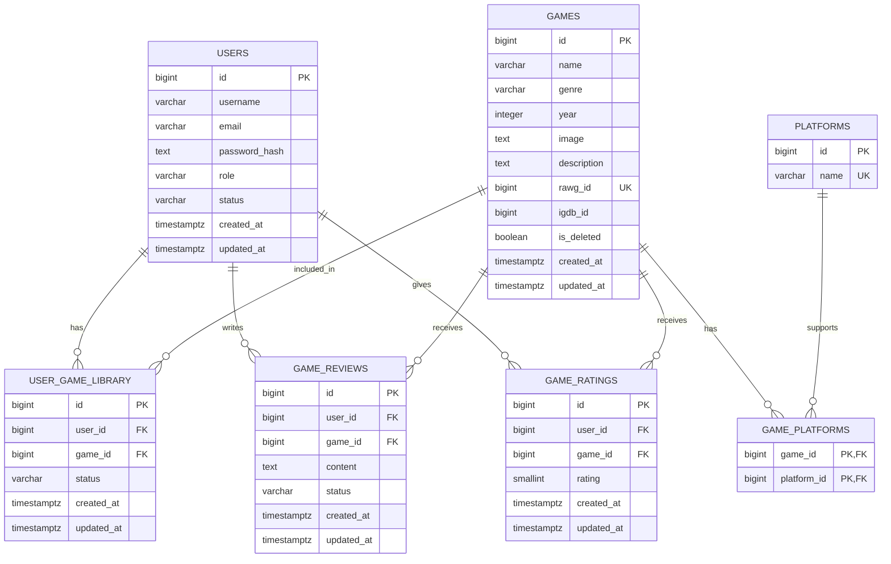

# GameHub Database Schema
เอกสารโครงสร้างฐานข้อมูลสำหรับทีมพัฒนา Backend (Go)

## 1. ภาพรวม

GameHub เป็นเว็บแอปพลิเคชันสำหรับค้นหาและจัดการข้อมูลเกม โดยแบ่งการใช้งานเป็น Guest, Member และ Admin

ระบบใช้ PostgreSQL บน Supabase เป็นฐานข้อมูล โดย Backend พัฒนาด้วยภาษา Go และเชื่อมต่อฐานข้อมูลผ่าน `database/sql` และ PostgreSQL driver `pgx`

เอกสารนี้อธิบายโครงสร้างฐานข้อมูล ความสัมพันธ์ระหว่างตาราง ข้อกำหนดของข้อมูล และแนวทางการนำข้อมูลไปใช้งานใน Backend

### เทคโนโลยีที่ใช้

| ส่วน | เทคโนโลยี |
|---|---|
| Database | PostgreSQL |
| Database Hosting | Supabase |
| Backend | Go |
| Database Driver | pgx |
| Authentication | JWT |
| Password Hashing | bcrypt |

### รายชื่อตารางทั้งหมด

ฐานข้อมูล GameHub มีทั้งหมด 7 ตาราง

| ตาราง | หน้าที่ |
|---|---|
| `games` | เก็บข้อมูลเกม |
| `users` | เก็บข้อมูลสมาชิกและบัญชีผู้ดูแลระบบ |
| `user_game_library` | เก็บเกมที่สมาชิกเพิ่มเข้าคลังส่วนตัว |
| `game_reviews` | เก็บรีวิวเกมจากสมาชิก |
| `game_ratings` | เก็บคะแนนที่สมาชิกให้เกม |
| `platforms` | เก็บข้อมูลแพลตฟอร์มเกม |
| `game_platforms` | เชื่อมความสัมพันธ์ระหว่างเกมกับแพลตฟอร์ม |

---

## 2. Entity Relationship Diagram (ER Diagram)

แสดงความสัมพันธ์ระหว่างตารางในฐานข้อมูล



### ความสัมพันธ์ระหว่างตาราง

| ความสัมพันธ์ | ประเภท | รายละเอียด |
|---|---|---|
| users → user_game_library | One-to-Many | สมาชิกหนึ่งคนมีเกมในคลังได้หลายเกม |
| games → user_game_library | One-to-Many | เกมหนึ่งเกมอยู่ในคลังของสมาชิกหลายคนได้ |
| users → game_reviews | One-to-Many | สมาชิกหนึ่งคนเขียนรีวิวได้หลายเกม |
| games → game_reviews | One-to-Many | เกมหนึ่งเกมมีรีวิวจากสมาชิกหลายคนได้ |
| users → game_ratings | One-to-Many | สมาชิกหนึ่งคนให้คะแนนได้หลายเกม |
| games → game_ratings | One-to-Many | เกมหนึ่งเกมได้รับคะแนนจากสมาชิกหลายคนได้ |
| games ↔ platforms | Many-to-Many | เกมหนึ่งเกมรองรับหลายแพลตฟอร์ม และแพลตฟอร์มหนึ่งมีหลายเกม |

ตาราง `game_platforms` เป็นตารางกลางสำหรับจัดการความสัมพันธ์แบบ Many-to-Many โดยใช้ Primary Key แบบ Composite Key ประกอบด้วย `game_id` และ `platform_id`

---

## 3. รายละเอียดโครงสร้างตาราง

ชนิดข้อมูลและสถานะ NULL ด้านล่างอ้างอิงจากโครงสร้างจริงใน Supabase

### 3.1 ตาราง games

เก็บข้อมูลเกมที่แสดงในระบบ

| Column | Data Type | Nullable | รายละเอียด |
|---|---|---|---|
| id | bigint | NO | Primary Key ของเกม |
| name | varchar | NO | ชื่อเกม |
| genre | varchar | YES | ประเภทหรือแนวเกม |
| year | integer | YES | ปีที่วางจำหน่าย |
| image | text | YES | URL หรือข้อมูลตำแหน่งรูปภาพ |
| description | text | YES | รายละเอียดเกม |
| rawg_id | bigint | YES | รหัสอ้างอิงเกมจาก RAWG |
| igdb_id | bigint | YES | รหัสอ้างอิงเกมจาก IGDB |
| is_deleted | boolean | NO | สถานะการลบเกม |
| created_at | timestamptz | NO | วันที่สร้างข้อมูล |
| updated_at | timestamptz | NO | วันที่แก้ไขข้อมูลล่าสุด |

**ข้อกำหนดสำคัญ**

- `id` เป็น Primary Key
- `rawg_id` มี Unique Constraint เพื่อป้องกันการบันทึกรหัส RAWG ซ้ำ
- `genre`, `year`, `image`, `description`, `rawg_id` และ `igdb_id` สามารถเป็น NULL ได้
- `is_deleted` ใช้สำหรับ Soft Delete
- เมื่อ Admin ลบเกม ระบบจะเปลี่ยน `is_deleted` เป็น TRUE แทนการลบข้อมูลออกจากฐานข้อมูลจริง
- เกมที่ถูก Soft Delete จะไม่แสดงในรายการเกมทั่วไปและรายละเอียดเกมตามเงื่อนไขของ Backend
- สามารถกู้คืนเกมได้โดยเปลี่ยน `is_deleted` กลับเป็น FALSE

### 3.2 ตาราง users

เก็บข้อมูลบัญชีสมาชิกและผู้ดูแลระบบ

| Column | Data Type | Nullable | รายละเอียด |
|---|---|---|---|
| id | bigint | NO | Primary Key ของผู้ใช้ |
| username | varchar | NO | ชื่อผู้ใช้ |
| email | varchar | NO | อีเมล |
| password_hash | text | NO | รหัสผ่านที่ผ่านการ Hash |
| role | varchar | NO | สิทธิ์ผู้ใช้งาน |
| status | varchar | NO | สถานะบัญชี |
| created_at | timestamptz | NO | วันที่สมัครสมาชิก |
| updated_at | timestamptz | NO | วันที่แก้ไขข้อมูลล่าสุด |

**ข้อกำหนดสำคัญ**

- `id` เป็น Primary Key
- `role` ใช้แยกสิทธิ์ `member` และ `admin`
- `status` ใช้ระบุสถานะบัญชี เช่น `active` และ `suspended`
- ระบบตรวจสอบชื่อผู้ใช้และอีเมลซ้ำโดยไม่สนตัวพิมพ์เล็กหรือใหญ่ผ่านการตรวจสอบใน Backend
- `password_hash` เก็บรหัสผ่านที่ผ่าน bcrypt เท่านั้น
- ห้ามส่ง `password_hash` กลับไปยัง Frontend
- Backend ใช้ JWT ในการยืนยันตัวตน และตรวจสอบสถานะบัญชีจากฐานข้อมูลก่อนอนุญาตให้ใช้งานฟังก์ชันที่ต้องเข้าสู่ระบบ

### 3.3 ตาราง user_game_library

เก็บรายการเกมในคลังส่วนตัวของสมาชิก

| Column | Data Type | Nullable | รายละเอียด |
|---|---|---|---|
| id | bigint | NO | Primary Key ของรายการคลัง |
| user_id | bigint | NO | Foreign Key อ้างอิง users.id |
| game_id | bigint | NO | Foreign Key อ้างอิง games.id |
| status | varchar | NO | สถานะการเล่นเกม |
| created_at | timestamptz | NO | วันที่เพิ่มเกมเข้าคลัง |
| updated_at | timestamptz | NO | วันที่แก้ไขข้อมูลล่าสุด |

**ข้อกำหนดสำคัญ**

- `user_id` อ้างอิง `users.id`
- `game_id` อ้างอิง `games.id`
- มี Unique Constraint แบบ Composite Key ที่ `(user_id, game_id)` เพื่อป้องกันสมาชิกเพิ่มเกมเดิมซ้ำในคลัง
- สมาชิกสามารถกำหนดสถานะเกมได้ 4 รูปแบบ

| Status | ความหมาย |
|---|---|
| `want_to_play` | ต้องการเล่น |
| `playing` | กำลังเล่น |
| `completed` | เล่นจบแล้ว |
| `dropped` | เลิกเล่น |

- หากไม่ได้ระบุสถานะตอนเพิ่มเกม Backend จะกำหนดค่าเริ่มต้นเป็น `want_to_play`
- สมาชิกสามารถเปลี่ยนสถานะหรือนำเกมออกจากคลังได้

### 3.4 ตาราง game_reviews

เก็บข้อความรีวิวเกมจากสมาชิก

| Column | Data Type | Nullable | รายละเอียด |
|---|---|---|---|
| id | bigint | NO | Primary Key ของรีวิว |
| user_id | bigint | NO | Foreign Key อ้างอิง users.id |
| game_id | bigint | NO | Foreign Key อ้างอิง games.id |
| content | text | NO | ข้อความรีวิว |
| status | varchar | NO | สถานะการแสดงรีวิว |
| created_at | timestamptz | NO | วันที่สร้างรีวิว |
| updated_at | timestamptz | NO | วันที่แก้ไขรีวิวล่าสุด |

**ข้อกำหนดสำคัญ**

- `user_id` อ้างอิง `users.id`
- `game_id` อ้างอิง `games.id`
- มี Unique Constraint แบบ Composite Key ที่ `(user_id, game_id)` เพื่อให้สมาชิกหนึ่งคนรีวิวเกมหนึ่งเกมได้หนึ่งรายการ
- ความยาวข้อความรีวิวที่ Backend รองรับคือ 1–5,000 ตัวอักษร
- สถานะรีวิวที่ใช้ในระบบ ได้แก่ `visible` และ `hidden`
- รีวิวที่มีสถานะ `visible` จะแสดงให้ผู้ใช้งานเห็น
- รีวิวที่มีสถานะ `hidden` จะไม่แสดงในรายการรีวิวทั่วไป
- สมาชิกสามารถแก้ไขและลบรีวิวของตนเองได้
- การแก้ไขหรือลบรีวิวต้องตรวจสอบเจ้าของรีวิวจาก User ID ใน JWT

### 3.5 ตาราง game_ratings

เก็บคะแนนที่สมาชิกให้กับเกม แยกจากตารางรีวิวเพื่อให้สมาชิกสามารถให้คะแนนได้โดยไม่จำเป็นต้องเขียนรีวิว

| Column | Data Type | Nullable | รายละเอียด |
|---|---|---|---|
| id | bigint | NO | Primary Key ของคะแนน |
| user_id | bigint | NO | Foreign Key อ้างอิง users.id |
| game_id | bigint | NO | Foreign Key อ้างอิง games.id |
| rating | smallint | NO | คะแนนเกม |
| created_at | timestamptz | NO | วันที่ให้คะแนน |
| updated_at | timestamptz | NO | วันที่แก้ไขคะแนนล่าสุด |

**ข้อกำหนดสำคัญ**

- `user_id` อ้างอิง `users.id`
- `game_id` อ้างอิง `games.id`
- มี Unique Constraint แบบ Composite Key ที่ `(user_id, game_id)`
- คะแนนที่ Backend รองรับคือ 1–5
- สมาชิกหนึ่งคนให้คะแนนเกมหนึ่งเกมได้หนึ่งคะแนน โดยสามารถแก้ไขคะแนนเดิมได้
- Backend ใช้ `ON CONFLICT (user_id, game_id) DO UPDATE` สำหรับการเพิ่มหรือเปลี่ยนคะแนน
- คะแนนเฉลี่ยและจำนวนผู้ให้คะแนนคำนวณจากข้อมูลในตารางนี้

### 3.6 ตาราง platforms

เก็บข้อมูลแพลตฟอร์มที่รองรับเกม

| Column | Data Type | Nullable | รายละเอียด |
|---|---|---|---|
| id | bigint | NO | Primary Key ของแพลตฟอร์ม |
| name | varchar | NO | ชื่อแพลตฟอร์ม |

**ข้อกำหนดสำคัญ**

- `id` เป็น Primary Key
- `name` มี Unique Constraint เพื่อป้องกันชื่อแพลตฟอร์มซ้ำ
- ใช้ร่วมกับ `game_platforms` เพื่อระบุว่าเกมรองรับแพลตฟอร์มใดบ้าง

### 3.7 ตาราง game_platforms

เป็นตารางกลางที่เชื่อมข้อมูลเกมกับแพลตฟอร์ม

| Column | Data Type | Nullable | รายละเอียด |
|---|---|---|---|
| game_id | bigint | NO | Primary Key และ Foreign Key อ้างอิง games.id |
| platform_id | bigint | NO | Primary Key และ Foreign Key อ้างอิง platforms.id |

**ข้อกำหนดสำคัญ**

- ใช้ Composite Primary Key `(game_id, platform_id)`
- `game_id` อ้างอิง `games.id`
- `platform_id` อ้างอิง `platforms.id`
- ป้องกันการเชื่อมเกมกับแพลตฟอร์มเดียวกันซ้ำ

---

## 4. Primary Key, Foreign Key และ Constraints

### 4.1 Primary Key

| ตาราง | Primary Key |
|---|---|
| games | id |
| users | id |
| user_game_library | id |
| game_reviews | id |
| game_ratings | id |
| platforms | id |
| game_platforms | (game_id, platform_id) |

### 4.2 Foreign Key

| ตารางต้นทาง | Column | ตารางปลายทาง | Column |
|---|---|---|---|
| user_game_library | user_id | users | id |
| user_game_library | game_id | games | id |
| game_reviews | user_id | users | id |
| game_reviews | game_id | games | id |
| game_ratings | user_id | users | id |
| game_ratings | game_id | games | id |
| game_platforms | game_id | games | id |
| game_platforms | platform_id | platforms | id |

### 4.3 Unique Constraints

| ตาราง | Column | จุดประสงค์ |
|---|---|---|
| games | rawg_id | ป้องกัน RAWG ID ซ้ำ |
| platforms | name | ป้องกันชื่อแพลตฟอร์มซ้ำ |
| user_game_library | user_id, game_id | สมาชิกเพิ่มเกมเดิมเข้าคลังซ้ำไม่ได้ |
| game_reviews | user_id, game_id | สมาชิกรีวิวเกมเดิมซ้ำไม่ได้ |
| game_ratings | user_id, game_id | สมาชิกให้คะแนนเกมเดิมซ้ำไม่ได้ |

### 4.4 Check Constraints

ฐานข้อมูลมี Check Constraint สำหรับตรวจสอบข้อมูลบางประเภท ได้แก่

- `games.year`
- `users.role`
- `users.status`
- `user_game_library.status`
- `game_reviews.content`
- `game_reviews.status`
- `game_ratings.rating`

หมายเหตุ: รายการข้างต้นอ้างอิงชื่อ Constraint ที่ตรวจพบใน Supabase แต่เอกสารนี้ยังไม่ได้ระบุ SQL expression ของแต่ละ Constraint เนื่องจากยังไม่ได้ดึงนิยาม CHECK แบบเต็มจากฐานข้อมูล

---

## 5. แนวทาง Mapping ระหว่าง Database กับ Go

Backend ใช้ `database/sql` ร่วมกับ PostgreSQL driver `pgx` ในการอ่านและเขียนข้อมูล

### 5.1 การแปลงชนิดข้อมูล

| PostgreSQL | Go |
|---|---|
| bigint | int64 |
| integer | int |
| smallint | int16 |
| varchar | string |
| text | string |
| boolean | bool |
| timestamptz | time.Time |
| nullable varchar/text | *string หรือ sql.NullString |
| nullable integer/bigint | *int, *int64 หรือ sql.NullInt64 |

ข้อมูลที่สามารถเป็น NULL ได้ ควรใช้ Pointer หรือ `sql.NullString`, `sql.NullInt64` เพื่อป้องกันข้อผิดพลาดระหว่าง Scan ข้อมูลจากฐานข้อมูล

### 5.2 Go Struct: Game

โครงสร้าง Game ที่ใช้งานอยู่ใน `models/game.go`

```go
package models

type Game struct {
    ID          int64   `json:"id"`
    Name        string  `json:"name"`
    Genre       *string `json:"genre"`
    Year        *int    `json:"year"`
    Image       *string `json:"image"`
    Description *string `json:"description"`
    IGDBID      *int64  `json:"igdb_id"`
}
```

หมายเหตุ:

- Struct นี้เป็น Model ที่ Backend ใช้งานอยู่ในปัจจุบัน
- `Genre`, `Year`, `Image`, `Description` และ `IGDBID` เป็น Pointer เนื่องจากข้อมูลในฐานข้อมูลสามารถเป็น NULL ได้
- `rawg_id` มีอยู่ใน Database แต่ยังไม่ได้อยู่ใน Struct และ Query ของ Game API ปัจจุบัน
- `created_at`, `updated_at` และ `is_deleted` มีอยู่ในตาราง แต่ไม่ได้ส่งออกใน Game JSON ปัจจุบัน

### 5.3 โครงสร้างข้อมูลอื่นที่ใช้ใน Backend

ตัวอย่าง Struct สำหรับ Mapping ข้อมูลตามตาราง

```go
type UserGameLibrary struct {
    ID        int64     `json:"id"`
    UserID    int64     `json:"user_id"`
    GameID    int64     `json:"game_id"`
    Status    string    `json:"status"`
    CreatedAt time.Time `json:"created_at"`
    UpdatedAt time.Time `json:"updated_at"`
}

type GameReview struct {
    ID        int64     `json:"id"`
    UserID    int64     `json:"user_id"`
    GameID    int64     `json:"game_id"`
    Content   string    `json:"content"`
    Status    string    `json:"status"`
    CreatedAt time.Time `json:"created_at"`
    UpdatedAt time.Time `json:"updated_at"`
}

type GameRating struct {
    ID        int64     `json:"id"`
    UserID    int64     `json:"user_id"`
    GameID    int64     `json:"game_id"`
    Rating    int16     `json:"rating"`
    CreatedAt time.Time `json:"created_at"`
    UpdatedAt time.Time `json:"updated_at"`
}

type Platform struct {
    ID   int64  `json:"id"`
    Name string `json:"name"`
}

type GamePlatform struct {
    GameID     int64 `json:"game_id"`
    PlatformID int64 `json:"platform_id"`
}
```

ตัวอย่าง Struct ในหัวข้อนี้เป็นแนวทาง Mapping เพิ่มเติม ไม่ใช่การยืนยันว่า Backend มี Model ครบทุก Struct แล้ว

---

## 6. แนวทางการจัดการข้อมูลใน Backend

### 6.1 การเพิ่มเกม

Backend เพิ่มข้อมูลเกมลงในตาราง `games`

```sql
INSERT INTO public.games
    (name, genre, year, image, description, igdb_id, is_deleted)
VALUES
    ($1, $2, $3, $4, $5, $6, FALSE)
RETURNING id, name, genre, year, image, description, igdb_id;
```

ข้อกำหนด:

- ต้องระบุชื่อเกม
- ชื่อเกมต้องไม่เป็นค่าว่าง
- ฟิลด์ที่เป็น Nullable สามารถส่งค่า NULL ได้
- เมื่อเพิ่มเกมใหม่ ให้กำหนด `is_deleted = FALSE`

### 6.2 การค้นหาและแสดงรายการเกม

Backend ใช้ `GET /api/games` สำหรับแสดงรายการเกม โดยรองรับการค้นหาด้วยชื่อและการแบ่งหน้า

```sql
SELECT id, name, genre, year, image, description, igdb_id
FROM public.games
WHERE is_deleted = FALSE
  AND ($1 = '' OR name ILIKE '%' || $1 || '%')
ORDER BY id ASC
LIMIT $2 OFFSET $3;
```

พารามิเตอร์:

| Parameter | รายละเอียด |
|---|---|
| q | คำค้นหาชื่อเกม |
| limit | จำนวนรายการต่อหน้า ค่าเริ่มต้น 20 และรับได้ 1–200 |
| offset | จำนวนรายการที่ข้าม ค่าเริ่มต้น 0 |

### 6.3 การแสดงรายละเอียดเกม

ใช้ `GET /api/games/{id}` เพื่อดึงรายละเอียดเกมตาม ID

```sql
SELECT id, name, genre, year, image, description, igdb_id
FROM public.games
WHERE id = $1
  AND is_deleted = FALSE;
```

หากไม่พบเกมหรือเกมถูก Soft Delete ให้ตอบกลับสถานะ Not Found

### 6.4 การแก้ไขเกม

ใช้ `UPDATE` เพื่อแก้ไขข้อมูลเกม และอัปเดต `updated_at`

```sql
UPDATE public.games
SET
    name = $1,
    genre = $2,
    year = $3,
    image = $4,
    description = $5,
    igdb_id = $6,
    updated_at = NOW()
WHERE id = $7
  AND is_deleted = FALSE;
```

### 6.5 การลบและกู้คืนเกม

GameHub ใช้ Soft Delete แทนการลบข้อมูลจริง

ลบเกม:

```sql
UPDATE public.games
SET is_deleted = TRUE,
    updated_at = NOW()
WHERE id = $1
  AND is_deleted = FALSE;
```

กู้คืนเกม:

```sql
UPDATE public.games
SET is_deleted = FALSE,
    updated_at = NOW()
WHERE id = $1
  AND is_deleted = TRUE;
```

การใช้ Soft Delete ช่วยรักษาความสัมพันธ์กับข้อมูลคลังเกม รีวิว และคะแนนของสมาชิก

---

## 7. การจัดการสมาชิก รีวิว คะแนน และคลังเกม

### 7.1 สมาชิกและการเข้าสู่ระบบ

การสมัครสมาชิกใช้ข้อมูล `username`, `email` และ `password`

Backend ต้องดำเนินการดังนี้:

1. ตรวจสอบข้อมูลที่ผู้ใช้ส่งมา
2. ตรวจสอบชื่อผู้ใช้และอีเมลซ้ำ
3. เข้ารหัสรหัสผ่านด้วย bcrypt
4. บันทึก Password Hash ลง `users.password_hash`
5. กำหนด Role เริ่มต้นเป็น Member ตามค่าเริ่มต้นของฐานข้อมูล

ตัวอย่างการตรวจสอบข้อมูล:

```sql
SELECT EXISTS (
    SELECT 1
    FROM public.users
    WHERE LOWER(TRIM(username)) = LOWER($1)
       OR LOWER(TRIM(email)) = LOWER($2)
);
```

การเข้าสู่ระบบ:

```sql
SELECT id, username, email, password_hash, role, status
FROM public.users
WHERE LOWER(TRIM(email)) = $1;
```

หลังจากตรวจสอบรหัสผ่านด้วย bcrypt สำเร็จ Backend จะสร้าง JWT Token เพื่อใช้ยืนยันตัวตนในการเรียก API ที่ต้องเข้าสู่ระบบ

### 7.2 คลังเกมส่วนตัว

เพิ่มเกมเข้าคลัง:

```sql
INSERT INTO user_game_library (user_id, game_id, status)
VALUES ($1, $2, $3)
RETURNING id;
```

ดูเกมในคลัง:

```sql
SELECT
    ugl.id,
    g.id,
    g.name,
    g.genre,
    g.year,
    g.image,
    g.description,
    ugl.status
FROM user_game_library ugl
JOIN games g ON g.id = ugl.game_id
WHERE ugl.user_id = $1
  AND g.is_deleted = FALSE
ORDER BY ugl.created_at DESC;
```

เปลี่ยนสถานะเกม:

```sql
UPDATE user_game_library
SET status = $1,
    updated_at = NOW()
WHERE id = $2
  AND user_id = $3;
```

นำเกมออกจากคลัง:

```sql
DELETE FROM user_game_library
WHERE id = $1
  AND user_id = $2;
```

ข้อกำหนดด้านความปลอดภัย:

- `user_id` ต้องอ่านจาก JWT Token
- ห้ามเชื่อถือ `user_id` ที่ส่งมาจาก Frontend
- ทุกครั้งที่แก้ไขหรือลบรายการคลัง ต้องตรวจสอบว่าเป็นข้อมูลของผู้ใช้ที่เข้าสู่ระบบจริง

### 7.3 รีวิวเกม

เพิ่มรีวิว:

```sql
INSERT INTO game_reviews (user_id, game_id, content)
VALUES ($1, $2, $3)
RETURNING id;
```

ดึงรีวิว:

```sql
SELECT
    gr.id,
    gr.user_id,
    u.username,
    gr.game_id,
    gr.content,
    COALESCE(rt.rating, 0),
    gr.status,
    gr.created_at,
    gr.updated_at
FROM game_reviews gr
JOIN users u ON u.id = gr.user_id
LEFT JOIN game_ratings rt
    ON rt.user_id = gr.user_id
   AND rt.game_id = gr.game_id
WHERE gr.game_id = $1
  AND gr.status = 'visible'
ORDER BY gr.created_at DESC;
```

แก้ไขรีวิว:

```sql
UPDATE game_reviews
SET content = $1,
    updated_at = NOW()
WHERE id = $2
  AND user_id = $3;
```

ลบรีวิว:

```sql
DELETE FROM game_reviews
WHERE id = $1
  AND user_id = $2;
```

ข้อกำหนด:

- สมาชิกต้องเข้าสู่ระบบก่อนเขียน แก้ไข หรือลบรีวิว
- รีวิวหนึ่งรายการต้องมีข้อความ 1–5,000 ตัวอักษร
- สมาชิกหนึ่งคนรีวิวเกมหนึ่งเกมได้หนึ่งครั้ง
- รีวิวที่ถูกซ่อนจะไม่แสดงใน API รายการรีวิวทั่วไป
- การแก้ไขและลบรีวิวต้องตรวจสอบเจ้าของรีวิว

### 7.4 คะแนนเกม

เพิ่มคะแนนหรือแก้ไขคะแนนเดิม:

```sql
INSERT INTO game_ratings (user_id, game_id, rating)
VALUES ($1, $2, $3)
ON CONFLICT (user_id, game_id)
DO UPDATE SET
    rating = EXCLUDED.rating,
    updated_at = NOW();
```

สรุปคะแนนเกม:

```sql
SELECT
    g.id,
    COALESCE(
        (
            SELECT ROUND(AVG(rating)::numeric, 2)
            FROM game_ratings
            WHERE game_id = g.id
        ),
        0
    )::float8 AS average_rating,
    (
        SELECT COUNT(*)
        FROM game_ratings
        WHERE game_id = g.id
    ) AS total_ratings,
    (
        SELECT COUNT(*)
        FROM game_reviews
        WHERE game_id = g.id
          AND status = 'visible'
    ) AS total_reviews
FROM games g
WHERE g.id = $1
  AND g.is_deleted = FALSE;
```

ข้อกำหนด:

- คะแนนต้องเป็นจำนวนเต็ม 1–5
- สมาชิกหนึ่งคนให้คะแนนเกมหนึ่งเกมได้หนึ่งคะแนน
- หากสมาชิกให้คะแนนเกมเดิมอีกครั้ง ให้แก้ไขคะแนนเดิมแทนการเพิ่มแถวใหม่
- คะแนนเฉลี่ยคำนวณจาก `game_ratings` ไม่ใช่จากข้อความรีวิว

### 7.5 ความสัมพันธ์ระหว่างรีวิวกับคะแนน

ในระบบ GameHub การเขียนรีวิวและการให้คะแนนสามารถเกิดขึ้นพร้อมกันได้

เมื่อสมาชิกสร้างรีวิว Backend จะบันทึกข้อมูลลง `game_reviews` และบันทึกคะแนนลง `game_ratings` ภายใน Transaction เดียวกัน

เมื่อสมาชิกแก้ไขรีวิว ระบบจะปรับปรุงคะแนนเดิมด้วย

เมื่อสมาชิกเลือกลบรีวิว Backend ปัจจุบันจะลบคะแนนของสมาชิกต่อเกมนั้นด้วย

ดังนั้นการเพิ่ม แก้ไข และลบข้อมูลที่เกี่ยวข้องทั้งสองตารางควรใช้ Transaction เพื่อป้องกันข้อมูลไม่ตรงกัน

---

## 8. Authentication และ Security

GameHub ใช้ JWT สำหรับการยืนยันตัวตน โดย Backend อ่านข้อมูลผู้ใช้จาก Token และตรวจสอบสถานะบัญชีจากฐานข้อมูล

### 8.1 การส่ง Token

Frontend ส่ง Token ผ่าน HTTP Header

```http
Authorization: Bearer <JWT_TOKEN>
```

### 8.2 Middleware

Backend มี Middleware สำคัญดังนี้

| Middleware | หน้าที่ |
|---|---|
| Auth | ตรวจสอบ JWT Token |
| Active | ตรวจสอบว่าบัญชีผู้ใช้ยังใช้งานได้ |
| Admin | ตรวจสอบว่าผู้ใช้มีสิทธิ์ Admin และบัญชียัง Active |

### 8.3 การควบคุมสิทธิ์

| ประเภทผู้ใช้ | สิทธิ์ |
|---|---|
| Guest | ดูรายการเกมและรายละเอียดเกม รวมถึงรีวิวและคะแนนสรุป |
| Member | ใช้งานฟังก์ชันสมาชิก เช่น คลังเกม รีวิว คะแนน และโปรไฟล์ |
| Admin | จัดการเกมและจัดการสถานะสมาชิก |

### 8.4 ข้อกำหนดด้านความปลอดภัย

- ห้ามส่ง Password Hash กลับไปยัง Frontend
- ห้ามรับ User ID จาก Request Body เพื่อระบุเจ้าของข้อมูลส่วนตัว
- ใช้ User ID จาก JWT Token ในการเข้าถึงข้อมูลสมาชิก
- ตรวจสอบสถานะบัญชีทุกครั้งที่เข้าถึง API ที่ต้องยืนยันตัวตน
- ตรวจสอบ Role จากฐานข้อมูลก่อนเข้าถึง API สำหรับ Admin
- ใช้ Parameterized Query เพื่อป้องกัน SQL Injection
- ใช้ bcrypt สำหรับจัดเก็บรหัสผ่าน
- เก็บ JWT Secret ใน Environment Variable ชื่อ `JWT_SECRET`

---

## 9. แนวทางการจัดการข้อมูลและข้อควรระวัง

### 9.1 การลบข้อมูลเกม

ไม่ควรลบข้อมูลจาก `games` โดยตรงในกรณีที่ยังมีข้อมูลสมาชิกอ้างอิงอยู่

ให้ใช้ Soft Delete ผ่าน `is_deleted` เพื่อรักษาข้อมูลรีวิว คะแนน และคลังเกม

### 9.2 การลบข้อมูลสมาชิก

ตารางที่เกี่ยวข้องกับสมาชิก ได้แก่

- `user_game_library`
- `game_reviews`
- `game_ratings`

ควรตรวจสอบพฤติกรรม Foreign Key และ ON DELETE ของฐานข้อมูลก่อนดำเนินการลบสมาชิกจริง เนื่องจากยังไม่ได้ยืนยันกติกาการลบแบบ CASCADE จากนิยาม Constraint

### 9.3 การจัดการข้อมูลที่เป็น NULL

ฟิลด์ที่สามารถเป็น NULL ได้ต้องรองรับใน Go โดยใช้ Pointer หรือ `sql.NullString`, `sql.NullInt64` ตามชนิดข้อมูล

ห้าม Scan ค่า NULL ลงตัวแปร Go แบบ Non-nullable โดยตรง

### 9.4 การอัปเดตเวลา

เมื่อแก้ไขข้อมูลที่มี `updated_at` ควรกำหนดค่าเป็น `NOW()` เพื่อบันทึกเวลาที่มีการเปลี่ยนแปลง

### 9.5 การจัดการ Transaction

ควรใช้ Transaction ในกรณีที่มีการเปลี่ยนแปลงข้อมูลมากกว่าหนึ่งตารางและต้องสำเร็จพร้อมกัน เช่น

- การสร้างรีวิวพร้อมคะแนน
- การแก้ไขรีวิวพร้อมคะแนน
- การลบรีวิวพร้อมคะแนน

หากขั้นตอนใดล้มเหลว ให้ Rollback เพื่อป้องกันข้อมูลไม่สอดคล้องกัน

### 9.6 แหล่งข้อมูลเกมภายนอก

ฐานข้อมูลมี `rawg_id` และ `igdb_id` สำหรับเก็บรหัสอ้างอิงเกมจากแหล่งข้อมูลภายนอก

การดึงข้อมูลจาก API ภายนอกหรือการ Sync ข้อมูลเกมเพิ่มเติมต้องกำหนดกระบวนการแยกต่างหาก โดยไม่ควรสมมติว่า Backend ปัจจุบันมีระบบ Sync อัตโนมัติแล้ว

---

## 10. การเชื่อมต่อฐานข้อมูล

Backend เชื่อมต่อ PostgreSQL ผ่าน Environment Variable

```env
DATABASE_URL=postgresql://...
JWT_SECRET=your-secret
ALLOWED_ORIGINS=http://localhost:3000
```

ตัวอย่างการเชื่อมต่อใน Go

```go
db, err := sql.Open("pgx", databaseURL)
if err != nil {
    return err
}

if err := db.Ping(); err != nil {
    db.Close()
    return err
}
```

ในระบบจริงควรใช้ Connection String จาก Supabase และจัดเก็บไว้ใน Environment Variables ของ Render โดยไม่เปิดเผยค่าให้ Frontend หรือ Repository สาธารณะ

### การตรวจสอบการเชื่อมต่อ

Backend มี Health Check Endpoint

```http
GET /api/health
```

ใช้ตรวจสอบว่า Backend ทำงานและสามารถเชื่อมต่อฐานข้อมูลได้หรือไม่

---

## 11. สรุปข้อกำหนดสำคัญสำหรับทีม Backend

| หัวข้อ | ข้อกำหนด |
|---|---|
| Database | PostgreSQL บน Supabase |
| จำนวนตาราง | 7 ตาราง |
| Game ID | ใช้ `games.id` เป็น Primary Key |
| External Game ID | รองรับ `rawg_id` และ `igdb_id` |
| User Role | member / admin |
| User Status | active / suspended |
| Library Status | want_to_play / playing / completed / dropped |
| Review Status | visible / hidden |
| Review Length | 1–5,000 ตัวอักษร |
| Rating | จำนวนเต็ม 1–5 |
| Review per User/Game | หนึ่งรีวิวต่อสมาชิกต่อเกม |
| Rating per User/Game | หนึ่งคะแนนต่อสมาชิกต่อเกม |
| Library per User/Game | หนึ่งรายการต่อสมาชิกต่อเกม |
| Authentication | JWT |
| Password Hashing | bcrypt |
| Game Delete | Soft Delete |
| Nullable Fields | ต้องรองรับ NULL ใน Go |
| Database Driver | pgx |

## 12. หมายเหตุเกี่ยวกับเอกสาร

เอกสารนี้จัดทำจากโครงสร้างตารางจริงใน Supabase และตรวจสอบร่วมกับโค้ด Backend GameHub ที่ใช้งานอยู่

รายละเอียดบางส่วน เช่น นิยาม SQL เต็มของ Check Constraints และพฤติกรรม ON DELETE ของ Foreign Keys ยังต้องตรวจสอบจากฐานข้อมูลเพิ่มเติมก่อนจัดทำเป็นเอกสาร DDL ฉบับสมบูรณ์

**วัตถุประสงค์:** ใช้เป็นเอกสารอ้างอิงกลางสำหรับทีม Frontend และ Backend เพื่อให้เข้าใจโครงสร้างข้อมูลและพัฒนาระบบ GameHub ไปในทิศทางเดียวกัน